# Data contracts

A data contract here is the triple **(Kafka topic, Avro schema, compatibility mode)**, and the
schema is *derived* from a ROS 2 message definition rather than written by hand.

## Lifecycle of a contract change

1. Edit a `.msg` under `contracts/msgs/` (for custom types) or vendor a new standard type.
2. Run `rtdaas-contracts gen` → regenerates `contracts/avro/*.avsc` and `contracts/avro/kafka/*.avsc`.
3. Open a PR. `contracts.yml` runs:
    - `rtdaas-contracts gen && git diff --exit-code` — generated files must be committed;
    - `rtdaas-contracts check --base origin/main --head contracts/avro --mode BACKWARD` — the
      pure-Python compatibility checker (`rtdaas.contracts.compat`) applies Avro schema-resolution
      rules and prints every incompatibility with its path.
4. After merge, the `contracts_sync` DAG (or the compose `registry-init` container) runs
   `rtdaas-contracts register`, which sets the subject compatibility and registers the new version.
5. Producers (bridge, simulator) and consumers (Spark jobs) fetch the latest schema for the
   subject at startup. Rolling restarts pick up the new version.

## What passes and what fails under BACKWARD

| Change in `.msg` | Result |
|---|---|
| Add a field **with** a default (`float64 speed 0`) | compatible |
| Add a field **without** a default | **incompatible** — new readers cannot read old records |
| Remove a field | compatible (readers ignore it) |
| `int32 → int64`, `float32 → float64` | compatible (promotion) |
| `float64 → float32`, `int64 → int32` | **incompatible** (narrowing) |
| Rename a field | **incompatible** unless an alias is declared in the generator |
| Change array element type | evaluated recursively |

`rtdaas-contracts diff --base origin/main` prints a human-readable field diff for PR descriptions.

## Mapping reference

The `.msg` → Avro mapping and the Kafka envelope are specified in
[spec §2.3](spec.md#23-ros-msg-avro-mapping-rtdaascontractsavro_gen). Key points:

- Record name = message type, namespace = ROS package (`rtdaas_msgs.ToolPose`).
- Envelope record `rtdaas.kafka.<Type>Record` adds `robot_id`, `ros_topic`, `recv_time_ns`.
- Constants become documentation; defaults become Avro defaults; comments become `doc`.
- Unsigned 32/64-bit integers map to `long` (Avro has no unsigned types); `uint64` values above
  2^63 are not representable and are rejected by the encoder.

## Wire format

`0x00` + big-endian 4-byte schema id + Avro binary ([ADR 0003](../adr/0003-wire-format-and-registry.md)).
Kafka headers `robot_id`, `ros_topic`, `msg_type`, `schema_id` carry the same routing information for
tools that do not decode values (kcat, Kafka UI).

## Bags are contracts too

Recorded MCAP files carry the message definition (`ros2msg` schema) inside the file. The batch
job decodes them with the **same** `.msg` registry (`rtdaas.contracts.cdr`), so a bag recorded with
an older message definition that has since changed incompatibly fails loudly in `decode_bag`
rather than producing silently wrong rows. The `schema_match` quality check then compares the
resulting table to the spec'd schema.
