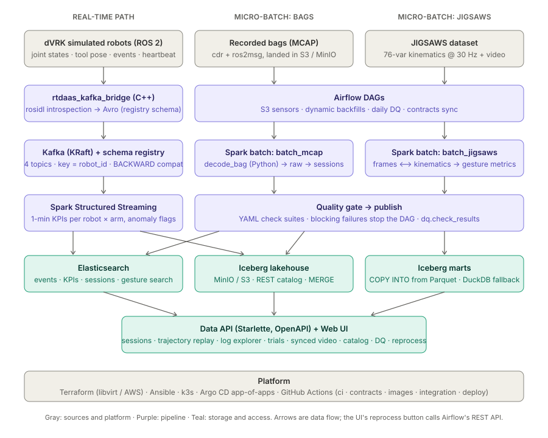

# robot-telemetry-daas

**A Data-as-a-Service platform for robot telemetry** — ROS 2 → Kafka → Spark (streaming +
batch) → Iceberg / Elasticsearch, orchestrated by Airflow, with enforced data
contracts, quality gates, a documented API and a web UI. Deployed with Terraform + Ansible + k3s
+ Argo CD, or on one machine with docker compose.



## What it does

- **Ingests** telemetry from a fleet of simulated da Vinci research arms (dVRK, ROS 2) in real
  time through a generic C++ ROS→Kafka bridge, and from recorded MCAP bags in daily batches.
- **Enforces contracts**: Avro schemas are generated from ROS `.msg` definitions, checked for
  backward compatibility on every PR, and registered in a schema registry; producers and
  consumers never embed schemas.
- **Computes** per-minute KPIs (streaming), per-session "economy of motion" metrics (batch), and
  per-gesture metrics that join da Vinci kinematics with endoscope video (JIGSAWS).
- **Gates** every publish on YAML-defined data-quality suites; results are a queryable table.
- **Serves** everything through a Starlette API with OpenAPI, a data catalog, and a UI with
  trajectory replay, log search, synchronized video + kinematics, and one-click reprocessing.

## Quick start (one machine)

```bash
git clone https://github.com/tom-f-oconnell/robot-telemetry-daas && cd robot-telemetry-daas
make install                # pip install -e .[dev,api,video]
make test                   # pure-Python unit tests (no cluster needed)
make synth                  # synthetic JIGSAWS dataset + simulated robot bags
make local-pipeline         # decode bags → sessions/KPIs; JIGSAWS → gestures; quality → SQLite
make api                    # http://localhost:8080  (UI, /docs for OpenAPI)
```

Full stack with Kafka, Spark, Airflow, Elasticsearch, MinIO and Iceberg:

```bash
make demo                   # docker compose --profile core --profile demo up
# Airflow  http://localhost:8085   Spark UI http://localhost:8082   API/UI http://localhost:8000
```

Multi-node: see [Terraform + Ansible + k3s](infra/kubernetes.md).

## Where to go next

| I want to… | Read |
|---|---|
| understand the design | [System design](architecture/overview.md), then the [ADRs](adr/0001-pure-python-core.md) |
| see exact schemas and interfaces | [Engineering spec](architecture/spec.md) |
| change a message / contract | [Data contracts](architecture/data-contracts.md), [schema change runbook](runbooks/schema-change.md) |
| find a table and its owner | [Data products & catalog](architecture/data-products.md) |
| operate the pipelines | [Pipelines](pipelines/streaming.md), [Runbooks](runbooks/backfill.md) |
| know what was actually executed | [Verification status](dev/verification.md) |
