# Multi-node: Terraform → Ansible → k3s → Argo CD



The same `infra/k8s` tree deploys to a 4-VM cluster on a workstation (libvirt/KVM) or on AWS.
Terraform creates machines and object storage and renders the Ansible inventory; Ansible installs
k3s and Argo CD; Argo CD reconciles everything else from git ([ADR 0008](../adr/0008-k3s-argocd-on-vms.md)).

## 1. Provision

=== "Local (libvirt)"

    ```bash
    cd infra/terraform/envs/local
    cp terraform.tfvars.example terraform.tfvars   # SSH public key, node sizing
    terraform init && terraform apply              # 4 × Ubuntu 24.04 cloud-image VMs, NAT network
    ```

    Needs KVM and ~48 GB RAM for the default 4 × 12 GB. MinIO runs in-cluster as the S3 endpoint.
    Host packages, and where to put the ~75 GB of VM disks (`pool_path`): see
    `infra/terraform/README.md`.

=== "AWS"

    ```bash
    cd infra/terraform/envs/aws
    cp terraform.tfvars.example terraform.tfvars   # SSH key, admin CIDR, region
    terraform init && terraform apply              # VPC, 4 × t3.xlarge, S3 buckets rtdaas-raw-*/rtdaas-lake-*, IAM instance role
    ```

    Buckets get versioning + SSE; the instance role is scoped to those two buckets. Destroy with
    `terraform destroy` when done — nothing here is designed to stay up unattended.

Both write `infra/ansible/inventory/hosts.ini` (`[k3s_server]` = first node, `[k3s_agent]` = rest).

## 2. Bootstrap

```bash
cd infra/ansible
ansible-galaxy collection install -r requirements.yml
ansible-playbook -i inventory/hosts.ini site.yml
export KUBECONFIG=$PWD/artifacts/kubeconfig.yaml
kubectl get applications -n argocd -w
```

Plays: `common` (packages, sysctl, swap off) → `k3s_server` (k3s v1.31, traefik disabled,
kubeconfig fetched) → `k3s_agent` (join) → `argocd` (helm, ingress-nginx, Argo CD, the
environment overlay ConfigMap, and `infra/k8s/argocd/root.yaml`).

## 3. What Argo CD deploys (`infra/k8s/argocd/apps/`)

| App | Source | Notes |
|---|---|---|
| strimzi-operator | Helm `strimzi-kafka-operator` 0.43 | |
| kafka-cluster | `manifests/kafka` | `Kafka` + `KafkaNodePool` (KRaft, 3 brokers), 4 `KafkaTopic` CRs from `registry.yml` |
| apicurio | `manifests/apicurio` | in-memory registry for demo; swap to the SQL variant for persistence |
| minio | `manifests/minio` | plain Deployment (MinIO withdrew its public images in 2025, which also broke the upstream chart); frozen `bitnamilegacy/minio` build by default, RustFS or real S3 are documented swaps; buckets auto-created (local env only) |
| iceberg-rest | `manifests/iceberg-rest` | REST catalog over the lake bucket |
| spark-operator | Helm (kubeflow) 2.0 | watches namespace `rtdaas` |
| eck-operator + elasticsearch | Helm `eck-operator` 2.14 + `Elasticsearch` CR | 1 node, no credentials for demo (anonymous superuser) |
| airflow | Helm `airflow` 1.15 | KubernetesExecutor, git-sync of `rtdaas/airflow/dags`, env from the rtdaas ConfigMap/Secret |
| kube-prometheus-stack | Helm 65.x | ServiceMonitors for api and Kafka |
| rtdaas | `manifests/rtdaas` (kustomize) | api (Ingress `rtdaas.local`), `SparkApplication/streaming-kpis`, sim, bridge |

Sync policy is automated with prune + self-heal; `CreateNamespace=true`.

## 4. Configuration and secrets

- `manifests/rtdaas/configmap.yaml` holds every non-secret setting from spec §9 with in-cluster
  hostnames (`kafka-cluster-kafka-bootstrap.kafka:9092`, `apicurio.registry:8080/apis/ccompat/v7`, …).
- `manifests/rtdaas/secret.yaml` is a template with `stringData` placeholders for the S3
  credentials. Replace it with a SealedSecret or External Secrets resource before committing real values.
- The Ansible `argocd` role writes an `rtdaas-env-overlay` ConfigMap with the environment's bucket
  names and region so the same manifests work on libvirt (MinIO) and AWS (S3).

## 5. Rollouts

`images.yml` pushes `ghcr.io/<owner>/rtdaas-{api,spark,airflow,sim,bridge}:<sha>` on every push to
`main`; `deploy.yml` then runs `kustomize edit set image …` in `manifests/rtdaas` and commits. Argo CD
notices the commit and rolls the Deployments / recreates the SparkApplication. Roll back by reverting
that commit.

## Sizing

| Node | Role | Runs |
|---|---|---|
| vm-0 | k3s server | control plane, Argo CD, ingress |
| vm-1..3 | agents | Kafka brokers (1 each, anti-affinity), Spark executors, Airflow workers, ES, MinIO |

The stack reserves about 28 GB before any batch job, and a batch job about 7 GB more (a driver and
two executors), so 4 × 8 GB cannot run batch beside streaming. On smaller hosts, shrink the streaming
job (`manifests/rtdaas/streaming-kpis.yaml`) and the Kafka replica count (`manifests/kafka`).
