# Batch bag ingestion

The authoritative copy of telemetry is the recorded bag. `telemetry_bag_ingest` runs daily
(and `telemetry_backfill` on demand) to turn `s3://rtdaas-raw/bags/<robot>/<yyyy>/<mm>/<dd>/*.mcap`
into raw tables, sessions and exact KPIs.



## Steps

| # | Task | What it does |
|---|---|---|
| 1 | `wait_for_bags` | `S3KeySensor` (reschedule mode, 6 h timeout) on the day's prefix |
| 2 | `spark_batch_mcap` | `batch_mcap.py --date {{ ds }}`: `sc.binaryFiles` over the prefix → `mapPartitions(decode_bag)` → `MERGE INTO` raw tables → sessions → KPIs |
| 3 | `quality_gate` | `quality_gate.py --suite quality/checks/telemetry.yml --partition {{ ds }}`; exit 2 on blocking failure |
| 4 | `publish_marts` | marts for the date → `lake.marts.*` (that day's partition) + catalog refresh |
| 5 | `index_es_sessions` | verifies the `rtdaas-sessions` document count for the date |

## Decoding bags

`decode_bag` (pure Python, `rtdaas/spark/decode.py`) reads the MCAP container with `mcap_lite`,
builds a message registry from the `ros2msg` schema **embedded in the bag** (falling back to the
repo's `contracts/msgs` only if a schema is missing) and decodes CDR payloads with
`rtdaas.contracts.cdr`. Rows are emitted per table with `robot_id` and `arm` taken from the ROS
topic path (`/dv_001/PSM1/…`), `ts` from the message header and `recv_ts` from the MCAP log time.

Because the function is plain Python it is unit-tested against bags written by the simulator,
and runs identically inside Spark and in `rtdaas-local pipeline`.

Bags reach the landing zone through `rtdaas-land` (`rtdaas/landing`), which derives the
`<robot>/<yyyy>/<mm>/<dd>/` key from the bag itself and only uploads closed files; the compose
stack runs it as the `bag-lander` service. Besides the Iceberg tables, `batch_mcap` indexes the
bag events and the exact KPI windows into Elasticsearch under the stream's document ids, so the
API's event search and the dashboards show bag data and the batch numbers replace the stream's
approximations there as they do in Iceberg.

## Sessions and KPIs

Per robot, events and heartbeats for the day are small and are collected to the driver to run
`split_sessions`; the resulting spine `(session_id, robot_id, start_ts, end_ts)` is joined back to
tool poses. `applyInPandas(session_metrics)` per `(session_id, robot_id, arm)` produces
`telemetry.sessions`; `applyInPandas(kpi_windows)` produces exact `telemetry.kpi_1m` rows with
`computed_by = 'batch'`, which replace the streaming approximations.

## Idempotency

Re-running a date is safe: raw merges on `(robot_id, arm, ts)`, sessions on `(session_id, arm)`,
KPIs on `(robot_id, arm, window_start)`, Elasticsearch ids are deterministic, and the mart
publish overwrites only the date's partition.

## Backfills

```bash
# Airflow UI → telemetry_backfill → Trigger w/ config
{"start_date": "2026-10-01", "end_date": "2026-10-07", "robot_id": "dv_002"}
```

The DAG expands one `batch_mcap` + `quality_gate` pair per date (dynamic task mapping, max 4
concurrent), then publishes once. See the [backfill runbook](../runbooks/backfill.md).
