# JIGSAWS: kinematics + video

The JIGSAWS dataset (JHU–Intuitive) contains synchronized da Vinci kinematics (76 variables at
30 Hz), stereo endoscope video and gesture annotations for suturing, knot-tying and needle-passing
trials. The platform treats it as a second batch source and joins video-derived features to the
kinematics at frame granularity.



## Dataset layout expected

```
<root>/
  Suturing/
    kinematics/AllGestures/Suturing_B001.txt      # 76 whitespace-separated floats per line, 30 Hz
    transcriptions/Suturing_B001.txt              # "<start_frame> <end_frame> G<n>" (1-based frames)
    video/Suturing_B001_capture1.avi              # 640×480 @ 30 fps (capture2 = right eye)
    meta_file_Suturing.txt                        # trial  skill(N/I/E)  GRS total  6 sub-scores
  Knot_Tying/ …   Needle_Passing/ …
```

Column order in the kinematics file: MTML (19), MTMR (19), PSML (19), PSMR (19); each 19 =
position (3), rotation matrix (9), linear velocity (3), angular velocity (3), gripper angle (1).

`rtdaas-jigsaws synth --out data/jigsaws` writes a synthetic dataset in exactly this layout
(including small rendered videos whose moving shapes track the synthetic PSM positions), so the
whole pipeline runs without the real data. Request the real dataset from JHU CIRL and point
`--root` at it; nothing else changes.

## Processing (`batch_jigsaws.py`)

1. `discover_trials(root)` on the driver → one `TrialMeta` per trial (skill level from the meta file).
2. `parallelize(trials)`; per trial on an executor:
    - `parse_kinematics` → 76 columns renamed to `<arm>_<field>`;
    - `parse_transcription` + `label_frames` → gesture label per frame;
    - `frame_features` (OpenCV) → per-frame mean intensity, motion energy, Laplacian sharpness;
    - `gesture_metrics` → per-segment path length, speed, gripper cycles, mean motion energy.
3. Write `procedures.trials`, `procedures.kinematics` (arm structs), `procedures.gestures`,
   `procedures.frame_features`; index gestures (with trial metadata) into `rtdaas-gestures`.
4. `quality_gate --suite procedures.yml` then publish `PROCEDURES.GESTURE_SKILL_SUMMARY`.

## Why frame features

Video and kinematics are recorded by different subsystems. Motion energy from the video should
track the kinematic speed of the instruments; a trial where they disagree (e.g. a frame offset or
a dropped segment) shows up as low correlation in the trial page and can be flagged with a `sql`
check. It is also the hook for richer video features later (tool detection, phase recognition)
without changing the table design.

## In the UI

The trial page plays the video with a kinematics scrubber: the current frame drives a cursor on
the PSM position/speed/gripper traces, the gesture ribbon shows which `G<n>` segment the frame is
in, and the frame-feature strip shows motion energy and sharpness. Gesture search filters
`procedures.gestures` by task, gesture code and skill level and jumps straight to the segment.
