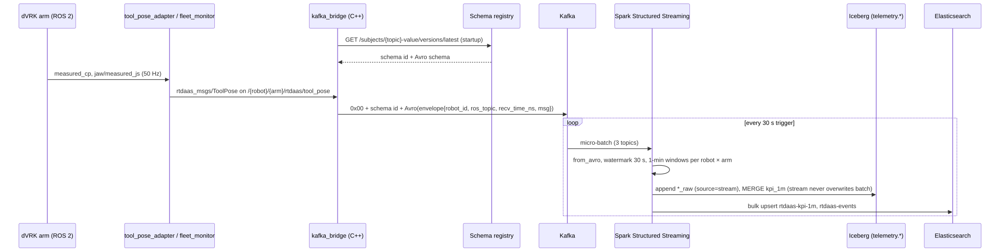

# Streaming KPIs

`rtdaas/spark/streaming_kpis.py` is the one long-running Spark job. It consumes three Kafka
topics and maintains one-minute KPIs per robot × arm with ~30 s end-to-end latency.



## Inputs

| Topic | Rate | Used for |
|---|---|---|
| `rtdaas.telemetry.tool_pose` | 50 Hz × arms × robots | speed, idle, path-length approximation, jaw |
| `rtdaas.telemetry.events` | sporadic | warn/error counts per window, log explorer |
| `rtdaas.telemetry.heartbeat` | 1 Hz × robots | heartbeat gap, liveness |

Values are Confluent-wire Avro; the job fetches the envelope schema for each subject from the
registry at startup and uses `from_avro(substring(value, 6, length(value) - 5), schema)`.

## Computation

```
tool_pose ──▶ withWatermark(ts, 30 s) ──▶ groupBy(window(ts, 1 min), robot_id, arm)
                 n_samples = count
                 mean_speed_mps = avg(speed)        max_speed_mps = max(speed)
                 idle_fraction  = avg(speed < 0.005)
                 path_length_m ≈ avg(speed) × (max(ts) − min(ts))      ← ADR 0006
                 jaw_cycles     = 0 (recomputed exactly by batch)
events    ──▶ same window, warn_events = count(severity = 2), error_events = count(severity ≥ 3)
heartbeat ──▶ same window, heartbeat_gap_s ≈ span / (count − 1)
```

The three aggregates are left-joined on `(robot_id, arm, window)`; events without an arm apply
to every arm of that robot.

## Sinks (`foreachBatch`)

1. Raw rows → `telemetry.tool_pose_raw`, `events_raw`, `heartbeat_raw` (append, `source = 'stream'`).
2. KPI rows → `MERGE INTO telemetry.kpi_1m` on `(robot_id, arm, window_start)`; the merge
   predicate excludes rows already computed by batch, so streaming never overwrites exact values.
3. KPIs and events → Elasticsearch bulk upsert with deterministic ids.

Checkpoint: `s3a://rtdaas-lake/checkpoints/streaming_kpis`. Output mode `update`, trigger
`30 seconds` (`--trigger`).

## Operating it

- **Compose:** `docker compose --profile demo up streaming` (depends on kafka, apicurio, minio, iceberg-rest, spark-master).
- **Kubernetes:** `SparkApplication/streaming-kpis` managed by spark-operator with `restartPolicy: Always`.
- **Metrics to watch:** Kafka consumer lag (kafka-exporter), `inputRowsPerSecond` and
  `batchDuration` from the Spark UI, `rtdaas-kpi-1m` freshness (the `streaming.yml` quality suite).
- **Schema upgrade:** restart the job after a new subject version is registered (see the
  [schema change runbook](../runbooks/schema-change.md)).
- **Late data:** anything later than 30 s past the watermark is dropped from the window
  aggregate but still appended to the raw tables; batch recomputes the window from bags.
